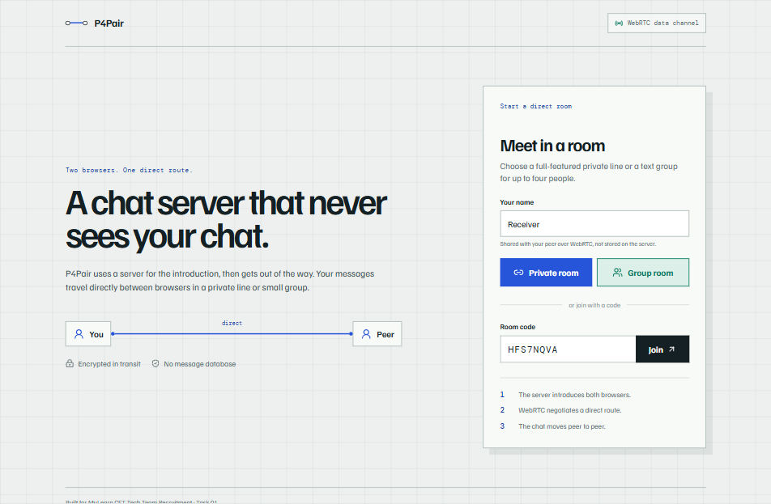
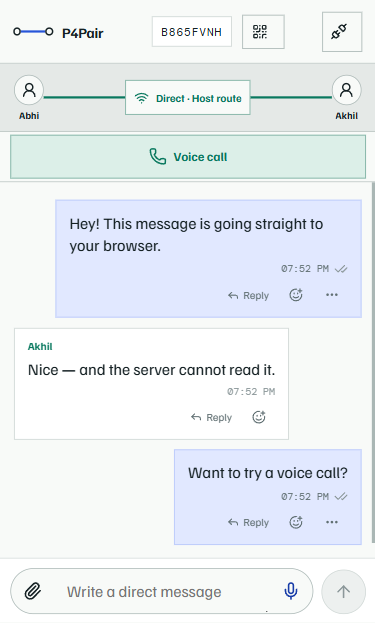
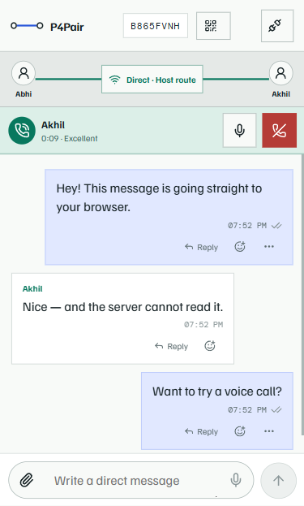

<p align="center">
  
</p>

<h1 align="center">P4Pair</h1>

<p align="center">
  A browser chat where messages travel directly between people.
</p>

<p align="center">
  <a href="https://p-for-pair.onrender.com/">Open the live app</a>
</p>

<p align="center">
  
  
  
</p>

## What is P4Pair?

P4Pair is a peer-to-peer chat app that runs in the browser. A small server helps people join the
same room. After that, messages, files and calls travel between their browsers using WebRTC.

The server handles room setup only. It does not receive chat text, files or call audio.

There are no accounts and no message database. Closing the page clears the conversation from that
browser.

## Main features

- Private rooms for two people
- Text group rooms for up to four people
- Real-time messages sent directly between browsers
- Clear waiting, connecting, connected and error states
- Works across different networks using STUN, with optional TURN support
- Shows the connection route and connection quality
- Responsive design for laptops and phones

## Extra features

- One-to-one voice calls with mute and hang-up controls
- Voice messages with waveforms
- File sharing up to 25 MB in private rooms
- Sent, delivered and seen ticks
- Replies, emoji reactions, message editing and deletion
- Usernames and typing indicators
- QR code invitations and native sharing
- Room recovery after a refresh or short disconnect
- Installable as a PWA

Group rooms are text-only. Files, voice messages and calls are available in private rooms.

## Run locally

```bash
npm install
npm run dev
```

Open `http://localhost:5173` in two browser tabs. Create a room in one tab and join it from the
other.

## Built with

React, TypeScript, WebRTC, WebSocket, Node.js and Vite.

## Documentation

- [Architecture](docs/ARCHITECTURE.md)
- [Design system](docs/DESIGN_SYSTEM.md)
- [Problems encountered](docs/PROBLEMS_ENCOUNTERED.md)
